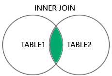
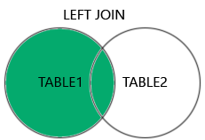
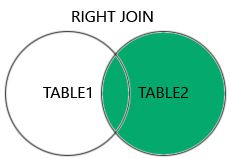
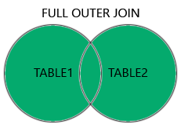
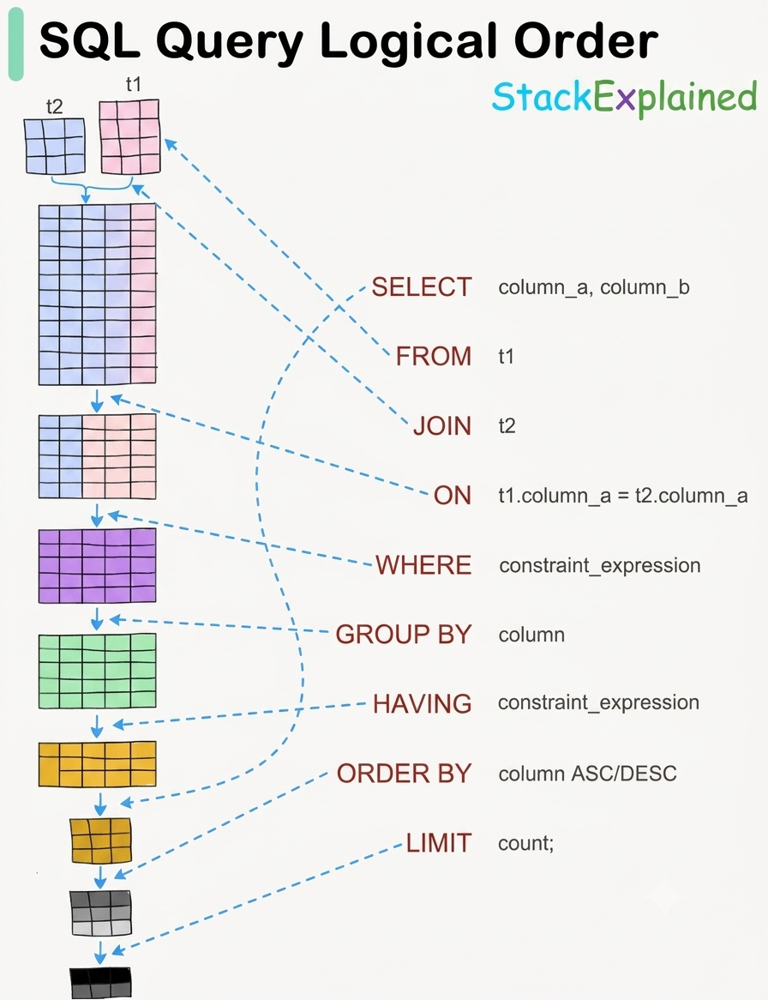
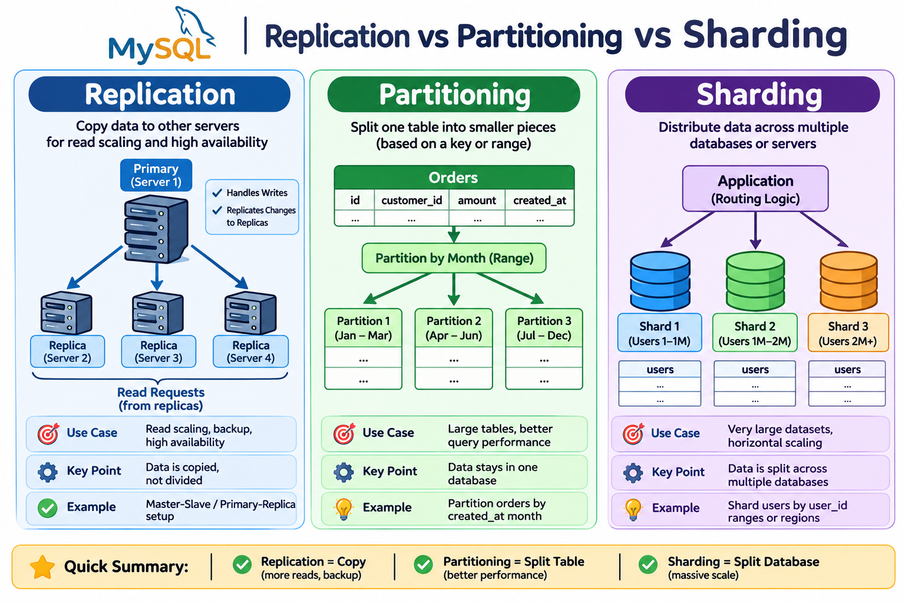

# SQL Interview Questions and Answers 🚀

## 1. What is SQL and MySQL?
**Answer :** SQL (Structured Query Language) is a language used to create, retrieve, modify and manage data in relational databases.
MySQL is a relational database management system that support SQL.

## 2. What are the different types of SQL commands?
**Answer :** SQL commands are commonly grouped into five categories.
 |Category |	Purpose | Examples |
| :--- | :--- | :--- |
|DDL (Data Definition Language) | Define database structures | CREATE, ALTER, DROP, TRUNCATE |
|DML (Data Manipulation Language) |	Modify data	| INSERT, UPDATE, DELETE |
|DQL (Data Query Language) | Retrieve data | SELECT |
|DCL (Data Control Language) | Manage permissions | GRANT, REVOKE |
|TCL (Transaction Control Language) | Manage transactions | COMMIT, ROLLBACK, SAVEPOINT |

## 3. What are primary keys and foreign keys?
**Answer :** A primary key uniquely identifies a row. A foreign key enforces a relationship with a referenced key in another table.
```js
CREATE TABLE customers (
    id INT PRIMARY KEY,
    name VARCHAR(100)
);

CREATE TABLE orders (
    id INT PRIMARY KEY,
    customer_id INT,
    amount DECIMAL(10,2),
    FOREIGN KEY (customer_id) REFERENCES customers(id)
);
```

## 4. What are SQL constraints?
**Answer :** Constraints enforce rules on stored data.
* **PRIMARY KEY :** Uniquely identifies each row.
* **UNIQUE :** Prevents duplicate key values.
* **NOT NULL :** Requires a value.
* **DEFAULT :** Supplies a value when one is not provided.
* **CHECK :** Validates a condition.

In MySQL, enforced **CHECK** constraints are supported in modern versions, including MySQL 8.0.16 and later.
```js
CREATE TABLE users (
    id INT PRIMARY KEY,
    email VARCHAR(255) UNIQUE,
    name VARCHAR(100) NOT NULL,
    age INT CHECK (age >= 18),
    country VARCHAR(50) DEFAULT 'India'
);
```

## 5. What is the difference between DELETE, TRUNCATE, and DROP?
**Answer :**
| Command | Effect |
| :--- | :--- |
| DELETE | Removes selected rows or all rows |
| TRUNCATE TABLE | Removes all rows efficiently by truncating the table |
| DROP TABLE | Removes the table definition and its data |

Important MySQL behavior:
- DELETE is a DML statement and can be rolled back when used in a suitable transaction with a transactional engine.
- TRUNCATE is DDL, causes an implicit commit, and is not rollbackable like ordinary transactional DML.
- TRUNCATE typically resets an AUTO_INCREMENT counter.
- TRUNCATE can be blocked by foreign-key references from other tables.

```js
DELETE FROM customers WHERE id = 4;

TRUNCATE TABLE customers;

DROP TABLE customers;
```

## 6. What are aliases in SQL?
**Answer :** Aliases provide temporary names to columns or tables in a query.
```js
SELECT
    c.name AS customer_name,
    o.amount AS order_amount
FROM customers AS c
JOIN orders AS o
    ON c.id = o.customer_id;
```

## 7. What is the difference between CHAR and VARCHAR?
**Answer :**
| CHAR(n) | VARCHAR(n) |
| :--- | :--- |
| Fixed-width character storage semantics | Variable-length character storage |
| Suitable for genuinely fixed-length values | Suitable for values with varying lengths |
| Can be useful for fixed-width codes | Often useful for names and emails |

## 8. What are aggregate functions?
**Answer :** Aggregate functions calculate a result from multiple rows.

Differences to remember:
- COUNT(*) counts rows.
- COUNT(column) counts non-NULL values in that column.
- SUM() calculates a total.
- AVG() calculates an average.
- MIN() and MAX() return the smallest and largest values.

```js
SELECT
    COUNT(*) AS total_orders,
    SUM(amount) AS total_amount,
    AVG(amount) AS average_amount,
    MIN(amount) AS minimum_amount,
    MAX(amount) AS maximum_amount
FROM orders;
```

## 9. What is the difference between WHERE and HAVING?
**Answer :** The core difference is that WHERE  filter rows before data is grouped, while HAVING filter rows after data is grouped by a GROUP BY clause.
| Feature | WHERE | HAVING |
| :--- | :--- | :--- |
| Execution Order | Execute before GROUP BY | Execute after GROUP BY |
| Applies To | Individual rows of data | Aggregated groups of rows |
| Aggregate Functions | Cannot contain aggregate functions (e.g., SUM(), COUNT(), AVG()). | Can contain and filter by aggregate functions. |
| Usage | Used with or without a GROUP BY clause. | Almost always requires a GROUP BY clause. |

## 10. Can we use HAVING without GROUP BY clause?
**Answer :** Yes, we can use HAVING without GROUP BY clause.
However, doing so behaves in a very specific way: the database treats the entire table as single, unified group.

When we use HAVING without GROUP BY, we must use an aggregate function (like COUNT(), SUM(), AVG(), MIN(), or MAX()) in either the SELECT or HAVING clause.

The query will evaluate the condition against the summary data of the entire table:
* If the condition is true, the query returns exactly one row (the summary).
* If the condition is false, the query returns zero rows.

## 11. What is JOIN and the different types of JOIN?
**Answer :** The JOIN clause is used to combine rows from two or more tables, based on a related column between them.

Types of JOIN
* **(INNER) JOIN :** Returns only rows that have matching values in both tables



* **LEFT (OUTER) JOIN :** Returns all rows from the left table, and only the matched rows from the right table



* **RIGHT (OUTER) JOIN :** Returns all rows from the right table, and only the matched rows from the left table



* **FULL (OUTER) JOIN :** Returns all rows when there is a match in either the left or right table



```js
// INNER JOIN Syntax
SELECT column_name(s)
FROM table1
INNER JOIN table2
ON table1.column_name = table2.column_name;

// LEFT JOIN Syntax
SELECT column_name(s)
FROM table1
LEFT JOIN table2
ON table1.column_name = table2.column_name;

// RIGHT JOIN Syntax
SELECT column_name(s)
FROM table1
RIGHT JOIN table2
ON table1.column_name = table2.column_name;

// FULL JOIN Syntax
SELECT column_name(s)
FROM table1
FULL JOIN table2
ON table1.column_name = table2.column_name
WHERE condition;
```

## 12. What is UNION and UNION ALL?
**Answer :**
The UNION and UNION ALL, both the operators are used to combine the result-set of two or more SELECT statements.

The UNION operator automatically removes duplicate rows from the result set.

The UNION ALL operator includes all rows from each statement, including any duplicates.

Requirements for UNION and UNION ALL:

* Every SELECT statement within UNION or UNION ALL must have the same number of columns
* The columns must also have similar data types
* The columns in every SELECT statement must also be in the same order

## 13. What is CASE in SQL?
**Answer :** CASE implements conditional logic inside a query.

It is useful for conditional labels, reports, calculated columns, and conditional aggregation.
```js
SELECT
    id,
    amount,
    CASE
        WHEN amount >= 2500 THEN 'HIGH'
        WHEN amount >= 1000 THEN 'MEDIUM'
        ELSE 'LOW'
    END AS order_category
FROM orders;
```

## 14. What is a VIEW?
**Answer :** A view is a named query that can be queried like a table.

A view does not store data. It only stores the SELECT query. Each time you query the view, the database runs that query on the actual tables, so you always see the latest data.
```js
CREATE VIEW paid_orders AS
SELECT id, customer_id, amount
FROM orders
WHERE status = 'PAID';

// Query it:
SELECT *
FROM paid_orders;
```

## 15. What is a subquery?
**Answer :** A subquery is a query nested inside another SQL query.
```js
SELECT *
FROM orders
WHERE amount > (
    SELECT AVG(amount)
    FROM orders
);
```

## 15. What is stored procedure and key benefits of it?
**Answer :** A stored procedure is a precompiled SQL code that can be saved and reused.

If you have an SQL query that you write over and over again, save it as a stored procedure, and then just call it to execute it.

A stored procedure can also have parameters, so it can act based on the parameter value(s) that is passed.

### Key Benefits of Stored Procedures

* **Code Reusability :** The same procedure can be called from various applications
* **Improved Performance :** Stored procedures are precompiled and runs faster
* **Database Security :** You can set users permission to run a specific procedure (limits direct access to tables)
* **Easy Maintenance :** When updating a procedure, it automatically updates all its use
```js
/////////////////////////////////// FOR SQL //////////////////////////////////////

// To create a stored procedure, use the CREATE PROCEDURE statement:
CREATE PROCEDURE procedure_name
  @param1 datatype,
  @param2 datatype
AS
BEGIN
  -- SQL_statements to be executed
  SELECT column1, column2
  FROM table_name
  WHERE columnN = @paramN;
END;

// To run a stored procedure, use the EXEC statement:
EXEC procedure_name @param1 = 'value1', @param2 = 'value2';
// To delete a stored procedure, use the DROP PROCEDURE statement:
DROP PROCEDURE procedure_name;

///////////////////////////////////// FOR MySQL //////////////////////////////////////

// To create a stored procedure, use the CREATE PROCEDURE statement:
DELIMITER //
CREATE PROCEDURE based_orders(
    IN p_rate DECIMAL(10, 2),
    IN p_status ENUM('placed', 'completed', 'cancelled')
)
BEGIN
    SELECT * 
    FROM orders
    WHERE status = p_status 
    AND rate > p_rate;
END //
DELIMITER ;

// To run a stored procedure, use the CALL statement:
CALL based_orders(10, 'completed')
// To delete a stored procedure, use the DROP PROCEDURE statement:
DROP PROCEDURE based_orders;

```

## 16. What is SQL Triggers?
**Answer :** A trigger in SQL is a special stored procedure that runs automatically when an INSERT, UPDATE or DELETE operation occurs on a table. 

It helps automate actions and keep data consistent.

### BEFORE and AFTER Triggers
SQL triggers can be specified to run BEFORE or AFTER the triggering event.

BEFORE Triggers run before an action (INSERT, UPDATE, DELETE) and are used for validation or changing values.

AFTER Triggers run after the action and are used for logging or updating other tables.
```js
// MySQL example: auto-fill a column before insert
CREATE TRIGGER set_created
BEFORE INSERT ON orders
FOR EACH ROW
SET NEW.created_at = NOW();

// MySQL example: log a change after it happens
CREATE TRIGGER log_price_change
AFTER UPDATE ON products
FOR EACH ROW
INSERT INTO price_log (product_id, old_price, new_price)
VALUES (OLD.id, OLD.price, NEW.price);
```

## 17. What is an index in MySQL?
**Answer :** An index is a data structure that helps MySQL find rows without scanning the entire table in many query patterns.

### Types of indexes
| Index type | Purpose |
| :--- | :--- |
| Primary key | Uniquely identifies rows |
| Unique index | Enforces uniqueness |
| Single-column index | Indexes one column |
| Composite index | Indexes multiple columns |
| Full-text index | Supports text-search operations |
| Spatial index | Supports spatial data queries |
| Functional index | Indexes an expression, where supported |
```js
CREATE UNIQUE INDEX idx_users_email
ON users(email);

CREATE INDEX idx_orders_status_date
ON orders(status, created_at);
```

## 18. What is SQL TRANSACTIONS?
**Answer :** An SQL transaction groups one or more SQL operations (e.g., INSERT, UPDATE, DELETE) into a single unit of work to ensure reliable data processing. It guarantees that all operations are completed successfully or none are applied, preserving data integrity.

* Ensures consistency by committing all changes together.
* Rolls back changes if any operation fails.
### SQL Transaction Control Commands
**1. BEGIN TRANSACTION Command :** Starts a new transaction. All SQL commands after this are treated as part of the same transaction until COMMIT or ROLLBACK is used.

**2. COMMIT Command :** The COMMIT command is used to save all changes made during the current transaction to the database. Once a transaction is committed, the changes are permanent.

**3. ROLLBACK Command :** The ROLLBACK command undoes all changes in the current transaction, useful if something goes wrong or you want to cancel the changes. The database will revert to the state it was in before the BEGIN TRANSACTION was executed.

**4. SAVEPOINT Command :** A SAVEPOINT is used to creates a point within the transaction. It lets you go back to a specific point without canceling the whole transaction.

**5. ROLLBACK TO SAVEPOINT Command :** Reverts work after the savepoint without ending the transaction.
```js
// Step 1: Start a new transaction
START TRANSACTION;

// Step 2: Deduct ₹100 from Account 1
UPDATE accounts
SET balance = balance - 100
WHERE id = 1;

// Step 3: Create a savepoint
SAVEPOINT after_debit;

// Step 4: Add ₹100 to Account 2
UPDATE accounts
SET balance = balance + 100
WHERE id = 2;

// Step 5: If the second operation fails,
// rollback to the savepoint
ROLLBACK TO SAVEPOINT after_debit;

// Step 6: If the entire transaction fails,
// rollback all changes
ROLLBACK;

// Step 7: If all operations succeed,
// permanently commit the changes
COMMIT;
```

## 19. What is ACID Properties in SQL?
**Answer :**
| Property | What it Means | How SQL Inforces It | Example 
| :--- | :--- | :--- | :--- |
| Atomicity | All or Nothing. Either every SQL statement in a transaction succeeds, or the entire transaction is cancelled (rolled back). Partial executions are impossible. | Managed using BEGIN TRANSACTION, COMMIT, and ROLLBACK commands. | If $100 is deducted from Account A, but the system crashes before adding it to Account B, the $100 is returned to Account A.
| Consistency | Valid State to Valid State. A transaction can only take the database from one valid state to another, strictly following all database rules and constraints. | Enforced through database constraints like PRIMARY KEY, FOREIGN KEY, CHECK, and NOT NULL. | If Account A has a rule saying its balance cannot drop below $0, a transaction attempting to withdraw more than the total balance will fail and reject the change.
| Isolation | Independence. Multiple transactions can execute concurrently without interfering with each other. The database acts as if transactions occur one after another. | Handled via locking mechanisms and Isolation Levels (e.g., Read Committed, Serializable) to prevent read errors. | If two people try to book the last remaining concert ticket at the exact same millisecond, the database isolates the actions so only one transaction succeeds, preventing double-booking.
| Durability | Permanence. Once a transaction is successfully completed (COMMIT), the changes are permanently saved in non-volatile memory. | Maintained using a Write-Ahead Log (WAL) or transaction logs that record changes to the disk before confirming success. | As soon as you see a "Transfer Successful" screen, those changes will not be lost even if the entire database server suddenly loses power or crashes right after.

## 20. What is the logical execution order of SQL query?
**Answer :** A conceptual logical order is:
1. FROM and JOIN
2. WHERE
3. GROUP BY
4. HAVING
5. SELECT
6. DISTINCT
7. ORDER BY
8. LIMIT



## 21. How do you optimize a slow SQL query?
**Answer :** Use a repeatable investigation process:
1. Identify the exact slow query and its typical parameter values.
2. Run EXPLAIN or, where safe, EXPLAIN ANALYZE.
3. Check rows examined, access methods, joins, sorting, and temporary-table operations.
4. Review indexes and whether their column order matches the workload.
5. Select only the necessary columns and rows.
6. Reduce unnecessary joins, repeated computations, and excessive data transfer.
7. Measure again with representative data and concurrency.

## 22. What is connection pooling?
**Answer :** Connection pooling reuses established database connections instead of opening a new connection for every request.

### Benefits:
* Lower connection-setup overhead.
* Controlled concurrency.
* Reduced connection churn.
* Better resource management.
```js
// For a Node.js backend, a pool can be configured using a MySQL driver:

import mysql from "mysql2/promise";

const pool = mysql.createPool({
  host: process.env.DB_HOST,
  user: process.env.DB_USER,
  password: process.env.DB_PASSWORD,
  database: process.env.DB_NAME,
  waitForConnections: true,
  connectionLimit: 10
});

const [rows] = await pool.execute(
  "SELECT id, name FROM customers WHERE id = ?",
  [1]
);
```

## 23. What is a lock in MySQL?
**Answer :**
A lock coordinates concurrent operations so they do not interfere in ways that violate transactional guarantees.

### Common concepts:
* **Shared locks :** permit compatible readers.
* **Exclusive locks :** protect changes to data.
* **Row-level locks :** protect records or index records/ranges involved in an operation.
* **Metadata locks :** coordinate access to database object definitions.
* **Intention locks :** indicate that a transaction intends to acquire finer-grained locks.

## 24. What is a deadlock?
**Answer**
A deadlock occurs when transactions wait on each other's locks in a cycle.

### Example:
* Transaction A locks row 1 and requests row 2.
* Transaction B locks row 2 and requests row 1.
* Neither can proceed without the other releasing a lock.
InnoDB detects deadlocks and normally rolls back one of the transactions to break the cycle.

### Ways to reduce deadlocks:
* Acquire rows in a consistent order.
* Keep transactions short.
* Add suitable indexes to reduce unnecessary locking.
* Retry transactions that fail with a deadlock error.
Deadlocks are not necessarily evidence of a broken database; applications must handle them safely.

## 25. What is a dirty read, non-repeatable read, and phantom read?
**Answer :**
* **Dirty read :** A transaction reads uncommitted data from another transaction.
* **Non-repeatable read :** Reading the same row twice returns different committed values.
* **Phantom read :** Repeating a range query finds a different set of qualifying rows.
```js
// Example of a phantom-like scenario:

// Transaction A:
START TRANSACTION;

SELECT *
FROM orders
WHERE amount > 2000;


// Transaction B inserts and commits another order with amount 2500.

// If Transaction A repeats the query, the result depends on its isolation level and read type. Under InnoDB's normal consistent snapshot reads in REPEATABLE READ, both reads generally use the same snapshot.
```

## 26. What is replication in MySQL?
**Answer :**
Replication copies database changes from a source server to one or more replica servers.

### Common uses:
* Read scaling.
* Reporting workloads.
* High availability architectures.
* Disaster recovery.
In a common asynchronous setup, a source commits a transaction and replicas apply its changes later.

That introduces a potential replication lag. A read immediately after a write may return stale data from a lagging replica.

For read-after-write consistency, applications can route relevant reads to the source or use an explicit consistency strategy.

## 27. What is partitioning?
**Answer :** Partitioning divides a table into smaller logical partitions managed by MySQL.

This is an illustrative quarterly partitioning scheme for a table whose primary key includes the partitioning column.

Partitioning can help with data lifecycle management and partition pruning, but it does not automatically speed up every query.
MySQL also imposes restrictions on unique keys and partitioning expressions, so design must account for those rules.

```js
CREATE TABLE events (
    id BIGINT NOT NULL,
    event_date DATE NOT NULL,
    payload JSON,
    PRIMARY KEY (id, event_date)
)
PARTITION BY RANGE COLUMNS(event_date) (
    PARTITION p2026q3
        VALUES LESS THAN ('2026-10-01'),
    PARTITION p2026q4
        VALUES LESS THAN ('2027-01-01'),
    PARTITION p_future
        VALUES LESS THAN (MAXVALUE)
);
```

## 28. What is sharding, and how is it different from partitioning?
**Answer :**
Partitioning divides data within a database table under one MySQL-managed table definition.

Sharding distributes data across separate database servers or independently managed database instances.

### Example:
* **Partitioning :** partition an events table by month.
* **Sharding :** store customers with IDs in one range on server A and another range on server B.

Sharding can increase horizontal capacity, but adds complexity around routing, joins, transactions, resharding, and operational management. It is not a substitute for first understanding indexes, query patterns, and workload bottlenecks.




# SQL Coding Problems

<div style="display: flex; gap: 40px;">
<div>

## Users
| id | name | email | status |
| :--- | :--- | :--- | :--- |
| 1 | Alice Smith | alice.smith@example.com | active |
| 2 | Bob Jones | bob.jones@example.com | active | 
| 3 | Charlie Brown | charlie.brown@example.com | inactive | 
| 4 | Diana Prince | diana.prince@example.com | active | 
| 5 | Evan Wright | alice.smith@example.com | active |

</div>
<div>

## Orders
| id | user_id | name | category | rate | status |
| :--- | :--- | :--- | :--- | :--- | :--- |
| 1 | 1 | Wireless Mouse | electronic | 29.99 | completed |
| 2 | 2 | Office Chair | furniture | 129.50 | completed |
| 3 | 3 | Cotton T-Shirt | clothes | 15.00 | completed |
| 4 | 4 | Bluetooth Speaker | electronic | 45.99 | completed |
| 5 | 2 | Wooden Bookshelf | furniture | 89.99 | cancelled |
| 6 | 1 | Running Shoes | clothes | 59.99 | completed |
| 7 | 4 | USB-C Hub | electronic | 34.50 | cancelled |
| 8 | 1 | Dining Table | furniture | 299.00 | completed |
| 9 | 2 | Denim Jacket | clothes | 75.00 | completed |
| 10 | 2 | Mechanical Keyboard | electronic | 89.00 | completed |

</div>
</div>


## 1. Find customers with more than one order.
**Answer :**
```js
SELECT u.id, u.name, COUNT(o.id) as total_orders
FROM users u 
JOIN orders o ON o.user_id = u.id
GROUP BY o.user_id
HAVING total_orders > 1;

// Result
id  name            total_orders
1   Alice Smith     3
2   Bob Jones       4
4   Diana Prince    2
```
## 2. Find customers who have never placed an order.
**Answer :**
```js
// Using subquery
SELECT u.id, u.name
FROM users u
WHERE NOT EXISTS (
	SELECT 1 
    FROM orders o
    WHERE o.user_id = u.id 
);

// Using JOIN
SELECT u.id, u.name
FROM users u 
LEFT JOIN orders o ON o.user_id = u.id
WHERE o.id IS NULL;

// Result
id      name
5       Evan Wright
```

## 3. Find duplicate email addresses.
**Answer :**
```js
SELECT email, COUNT(email) AS email_count 
FROM users
GROUP BY email
HAVING email_count > 1;

// Result
email                       email_count
alice.smith@example.com     2
```

## 4. Find the second-highest rate.
**Answer :**
```js
SELECT id, user_id, name, category, rate  
FROM orders
ORDER BY rate DESC
LIMIT 1
OFFSET 1;

// Result
id      user_id     name            category    rate
2       2           Office Chair    furniture   129.50
```

## 5. Find the highest order amount for each customer.
**Answer :**
```js
SELECT u.id, u.name, MAX(o.rate) as m_rate
FROM users u
JOIN orders o ON o.user_id = u.id
GROUP BY o.user_id;

// Result
id      name            m_rate
1       Alice Smith     299.00
2       Bob Jones       129.50
3       Charlie Brown   15.00
4       Diana Prince    45.99
```

## 6. Find orders above the overall average amount.
**Answer :**
```js
SELECT * 
FROM orders 
WHERE rate > ( 
    SELECT AVG(rate) as a_rate FROM orders
);

// Result
id   user_id    name                    category        rate
2    2          Office Chair            furniture       129.50
5    2          Wooden Bookshelf        furniture       89.99
8    1          Dining Table            furniture       299.00
10   2          Mechanical Keyboard     electronic      89.00
```

