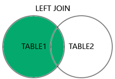
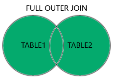

# JWT Interview Questions and Answers 🚀

## 1. What is SQL and MySQL?
**Answer :** SQL (Structured Query Language) is a language used to create, retrieve, modify and manage data in relational databases.
MySQL is a relational database management system that support SQL.

## 2. What are the different types of SQL commands?
**Answer :** SQL commands are commonly grouped into five categories.
|Category |	Purpose | Examples |
| :--- | :--- | :--- |
|DDL (Data Definition Language) | Define database structures | CREATE, ALTER, DROP, TRUNCATE |
|DML (Data Manipulation Language) |	Modify data	| INSERT, UPDATE, DELETE |
|DQL (Data Query Language) | Retrieve data | SELECT |
|DCL (Data Control Language) | Manage permissions | GRANT, REVOKE |
|TCL (Transaction Control Language) | Manage transactions | COMMIT, ROLLBACK, SAVEPOINT |

## 3. What are primary keys and foreign keys?
**Answer :** A primary key uniquely identifies a row. A foreign key enforces a relationship with a referenced key in another table.
```js
CREATE TABLE customers (
    id INT PRIMARY KEY,
    name VARCHAR(100)
);

CREATE TABLE orders (
    id INT PRIMARY KEY,
    customer_id INT,
    amount DECIMAL(10,2),
    FOREIGN KEY (customer_id) REFERENCES customers(id)
);
```

## 4. What are SQL constraints?
**Answer :** Constraints enforce rules on stored data.
* **PRIMARY KEY :** Uniquely identifies each row.
* **UNIQUE :** Prevents duplicate key values.
* **NOT NULL :** Requires a value.
* **DEFAULT :** Supplies a value when one is not provided.
* **CHECK :** Validates a condition.

In MySQL, enforced **CHECK** constraints are supported in modern versions, including MySQL 8.0.16 and later.
```js
CREATE TABLE users (
    id INT PRIMARY KEY,
    email VARCHAR(255) UNIQUE,
    name VARCHAR(100) NOT NULL,
    age INT CHECK (age >= 18),
    country VARCHAR(50) DEFAULT 'India'
);
```

## 5. What is the difference between DELETE, TRUNCATE, and DROP?
**Answer :**
| Command | Effect |
| :--- | :--- |
| DELETE | Removes selected rows or all rows |
| TRUNCATE TABLE | Removes all rows efficiently by truncating the table |
| DROP TABLE | Removes the table definition and its data |

Important MySQL behavior:
- DELETE is a DML statement and can be rolled back when used in a suitable transaction with a transactional engine.
- TRUNCATE is DDL, causes an implicit commit, and is not rollbackable like ordinary transactional DML.
- TRUNCATE typically resets an AUTO_INCREMENT counter.
- TRUNCATE can be blocked by foreign-key references from other tables.

```js
DELETE FROM customers WHERE id = 4;

TRUNCATE TABLE customers;

DROP TABLE customers;
```

## 6. What are aliases in SQL?
**Answer :** Aliases provide temporary names to columns or tables in a query.
```js
SELECT
    c.name AS customer_name,
    o.amount AS order_amount
FROM customers AS c
JOIN orders AS o
    ON c.id = o.customer_id;
```

## 7. What is the difference between CHAR and VARCHAR?
**Answer :**
| CHAR(n) | VARCHAR(n) |
| :--- | :--- |
| Fixed-width character storage semantics | Variable-length character storage |
| Suitable for genuinely fixed-length values | Suitable for values with varying lengths |
| Can be useful for fixed-width codes | Often useful for names and emails |

## 8. What are aggregate functions?
**Answer :** Aggregate functions calculate a result from multiple rows.

Differences to remember:
- COUNT(*) counts rows.
- COUNT(column) counts non-NULL values in that column.
- SUM() calculates a total.
- AVG() calculates an average.
- MIN() and MAX() return the smallest and largest values.

```js
SELECT
    COUNT(*) AS total_orders,
    SUM(amount) AS total_amount,
    AVG(amount) AS average_amount,
    MIN(amount) AS minimum_amount,
    MAX(amount) AS maximum_amount
FROM orders;
```

## 9. What is the difference between WHERE and HAVING?
**Answer :** The core difference is that WHERE  filter rows before data is grouped, while HAVING filter rows after data is grouped by a GROUP BY clause.
| Feature | WHERE | HAVING |
| :--- | :--- | :--- |
| Execution Order | Execute before GROUP BY | Execute after GROUP BY |
| Applies To | Individual rows of data | Aggregated groups of rows |
| Aggregate Functions | Cannot contain aggregate functions (e.g., SUM(), COUNT(), AVG()). | Can contain and filter by aggregate functions. |
| Usage | Used with or without a GROUP BY clause. | Almost always requires a GROUP BY clause. |

## 10. Can we use HAVING without GROUP BY clause?
**Answer :** Yes, we can use HAVING without GROUP BY clause.
However, doing so behaves in a very specific way: the database treats the entire table as single, unified group.

When we use HAVING without GROUP BY, we must use an aggregate function (like COUNT(), SUM(), AVG(), MIN(), or MAX()) in either the SELECT or HAVING clause.

The query will evaluate the condition against the summary data of the entire table:
* If the condition is true, the query returns exactly one row (the summary).
* If the condition is false, the query returns zero rows.

## 11. What is JOIN and the different types of JOIN?
**Answer :** The JOIN clause is used to combine rows from two or more tables, based on a related column between them.

Types of JOIN
* **(INNER) JOIN :** Returns only rows that have matching values in both tables


* **LEFT (OUTER) JOIN :** Returns all rows from the left table, and only the matched rows from the right table



* **RIGHT (OUTER) JOIN :** Returns all rows from the right table, and only the matched rows from the left table


* **FULL (OUTER) JOIN :** Returns all rows when there is a match in either the left or right table



```js
// INNER JOIN Syntax
SELECT column_name(s)
FROM table1
INNER JOIN table2
ON table1.column_name = table2.column_name;

// LEFT JOIN Syntax
SELECT column_name(s)
FROM table1
LEFT JOIN table2
ON table1.column_name = table2.column_name;

// RIGHT JOIN Syntax
SELECT column_name(s)
FROM table1
RIGHT JOIN table2
ON table1.column_name = table2.column_name;

// FULL JOIN Syntax
SELECT column_name(s)
FROM table1
FULL JOIN table2
ON table1.column_name = table2.column_name
WHERE condition;
```

## 12. What is UNION and UNION ALL?
**Answer :**
The UNION and UNION ALL, both the operators are used to combine the result-set of two or more SELECT statements.

The UNION operator automatically removes duplicate rows from the result set.

The UNION ALL operator includes all rows from each statement, including any duplicates.

Requirements for UNION and UNION ALL:

* Every SELECT statement within UNION or UNION ALL must have the same number of columns
* The columns must also have similar data types
* The columns in every SELECT statement must also be in the same order

## 13. What is CASE in SQL?
**Answer :** CASE implements conditional logic inside a query.

It is useful for conditional labels, reports, calculated columns, and conditional aggregation.
```js
SELECT
    id,
    amount,
    CASE
        WHEN amount >= 2500 THEN 'HIGH'
        WHEN amount >= 1000 THEN 'MEDIUM'
        ELSE 'LOW'
    END AS order_category
FROM orders;
```

## 14. What is a view?
**Answer :** A view is a named query that can be queried like a table.

A view does not store data. It only stores the SELECT query. Each time you query the view, the database runs that query on the actual tables, so you always see the latest data.
```js
CREATE VIEW paid_orders AS
SELECT id, customer_id, amount
FROM orders
WHERE status = 'PAID';

// Query it:
SELECT *
FROM paid_orders;
```

## 15. What is a subquery?
**Answer :** A subquery is a query nested inside another SQL query.
```js
SELECT *
FROM orders
WHERE amount > (
    SELECT AVG(amount)
    FROM orders
);
```

## 16. What is stored procedure and key benefits of it?
**Answer :** A stored procedure is a precompiled SQL code that can be saved and reused.

If you have an SQL query that you write over and over again, save it as a stored procedure, and then just call it to execute it.

A stored procedure can also have parameters, so it can act based on the parameter value(s) that is passed.

### Key Benefits of Stored Procedures

* **Code Reusability :** The same procedure can be called from various applications
* **Improved Performance :** Stored procedures are precompiled and runs faster
* **Database Security :** You can set users permission to run a specific procedure (limits direct access to tables)
* **Easy Maintenance :** When updating a procedure, it automatically updates all its use
```js
/////////////////////////////////// FOR SQL //////////////////////////////////////
// To create a stored procedure, use the CREATE PROCEDURE statement:
CREATE PROCEDURE procedure_name
  @param1 datatype,
  @param2 datatype
AS
BEGIN
  -- SQL_statements to be executed
  SELECT column1, column2
  FROM table_name
  WHERE columnN = @paramN;
END;

// To run a stored procedure, use the EXEC statement:
EXEC procedure_name @param1 = 'value1', @param2 = 'value2';
// To delete a stored procedure, use the DROP PROCEDURE statement:
DROP PROCEDURE procedure_name;

///////////////////////////////////// FOR MySQL //////////////////////////////////////
// To create a stored procedure, use the CREATE PROCEDURE statement:
DELIMITER //
CREATE PROCEDURE based_orders(
    IN p_rate DECIMAL(10, 2),
    IN p_status ENUM('placed', 'completed', 'cancelled')
)
BEGIN
    SELECT * 
    FROM orders
    WHERE status = p_status 
    AND rate > p_rate;
END //
DELIMITER ;

// To run a stored procedure, use the CALL statement:
CALL based_orders(10, 'completed')
// To delete a stored procedure, use the DROP PROCEDURE statement:
DROP PROCEDURE based_orders;

```

## 1. What is ACID Properties in sql?
**Answer :**
| Property | What it Means | How SQL Inforces It | Example 
| :--- | :--- | :--- | :--- |
| Atomicity | All or Nothing. Either every SQL statement in a transaction succeeds, or the entire transaction is cancelled (rolled back). Partial executions are impossible. | Managed using BEGIN TRANSACTION, COMMIT, and ROLLBACK commands. | If $100 is deducted from Account A, but the system crashes before adding it to Account B, the $100 is returned to Account A.
| Consistency | Valid State to Valid State. A transaction can only take the database from one valid state to another, strictly following all database rules and constraints. | Enforced through database constraints like PRIMARY KEY, FOREIGN KEY, CHECK, and NOT NULL. | If Account A has a rule saying its balance cannot drop below $0, a transaction attempting to withdraw more than the total balance will fail and reject the change.
| Isolation | Independence. Multiple transactions can execute concurrently without interfering with each other. The database acts as if transactions occur one after another. | Handled via locking mechanisms and Isolation Levels (e.g., Read Committed, Serializable) to prevent read errors. | If two people try to book the last remaining concert ticket at the exact same millisecond, the database isolates the actions so only one transaction succeeds, preventing double-booking.
| Durability | Permanence. Once a transaction is successfully completed (COMMIT), the changes are permanently saved in non-volatile memory. | Maintained using a Write-Ahead Log (WAL) or transaction logs that record changes to the disk before confirming success. | As soon as you see a "Transfer Successful" screen, those changes will not be lost even if the entire database server suddenly loses power or crashes right after.

